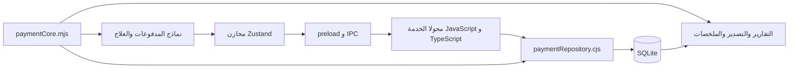

# تقرير تدقيق وإصلاح نظام المدفوعات

تاريخ التنفيذ: 18 نوفمبر 2026. مرجع الشفرة قبل العمل: `1f9f64e`.

## 1. حالة النظام قبل الإصلاح

كانت نقطة التشغيل الفعلية `electron/main.js` تستخدم خدمة SQLite المكتوبة بـJavaScript، مع تنفيذ TypeScript موازٍ يكرر العمليات المالية. واجهات المدفوعات ومخازن Zustand والتقارير والتصدير كانت تحسب بعض الأرقام بصورة مستقلة.

أُنشئ تقرير التحليل قبل التعديل في [payment-audit-ar.md](payment-audit-ar.md)، ثم شُغّل اختباران مرجعيان للسلوك الصحيح قبل إصلاح التنفيذ. نجح إنشاء سجلين مباشرين بقيمتي 30 و20، ونجح تعديل دفعة 30 إلى 35 عندما لا توجد دفعات أخرى.



## 2. السبب الجذري والمشكلات المكتشفة

- كانت نافذة الإضافة تبحث عن دفعة سابقة للعلاج ثم تستدعي `updatePayment` بمجموع المبلغ القديم والجديد. هذا دمج الدفعات وغيّر بيانات السجل السابق.
- كان الاستثناء بمعرف الدفعة موجوداً بالفعل في مسار التعديل؛ المشكلة لم تكن غياب الاستثناء وحده، بل دخول عملية الإضافة إلى التعديل، مع اختلاف المبلغ المستخدم في الحساب الخلفي عن التقارير.
- بعض العمليات الخلفية جمعت `amount`، بينما تقارير أخرى جمعت `total_amount` بعد الضريبة والخصم.
- إعادة الحساب القديمة كانت تجمع حالات غير محصلة وتعيد تصنيف دفعات ملغاة أو مستردة كمدفوعة.
- استُخدم `amount_paid` التراكمي كإيراد للدفعة في بعض تقارير التحقق والتصدير، مما يكرر احتساب التحصيل.
- كانت واجهة تعديل تكلفة العلاج تعيد كتابة وصف وملاحظات وحالة دفعاته، رغم وجود مسار خلفي لحساب الرصيد.
- حفظ العلاج والدفعة كان منفصلاً. لم يكن يوجد مسار ذري للدفع الفوري أو مفتاح دائم لإعادة محاولة العملية.
- كانت الدفعة الشاملة تحذف سجلات معلقة عند اكتمال العلاج، وتتجاهل توزيع الخصومات والضرائب بصورة متسقة.
- احتُسبت بعض السجلات المرتبطة بعلاج وموعد مرتين، واعتُبر الصفر أحياناً قيمة مفقودة بسبب استخدام `||`.
- كانت إعادة ترتيب العلاجات تحذفها ثم تعيد إدراجها، مما قد يحذف دفعاتها عبر `ON DELETE CASCADE`. استُبدلت بتحديث الأولويات داخل معاملة، مع مرحلة مؤقتة تمنع تعارض القيد الفريد.
- كانت بعض معالجات IPC تعيد نجاحاً وهمياً عند غياب قاعدة البيانات. أصبحت عمليات الكتابة المالية ترفض العملية بوضوح.

## 3. المنطق المالي الموحد

`paymentCore.mjs` هو المصدر المشترك لحساب المبالغ والحالات والأرصدة والتحقق والمعاينات. `paymentRepository.cjs` ينفذ إنشاء الدفعات وتعديلها وحذفها والدفع الشامل وحفظ العلاج مع الدفع الفوري. خدمتا JavaScript وTypeScript تفوضان هذه العمليات إليه مع إبقاء أسماء الاستدعاءات وعقودها القائمة.

السياسة المستخدمة هي السياسة القائمة في التقارير الحديثة:

```text
مبلغ السجل الصافي = amount + tax_amount - discount_amount
المبلغ المحصل = SUM(total_amount ?? amount)
                للحالات completed / partial / paid فقط
الرصيد = MAX(0, تكلفة العلاج - المبلغ المحصل)
```

تجري العمليات الحسابية بوحدات نقدية صحيحة من منزلتين عشريتين، وتعود الواجهات إلى الأرقام المعتادة. لا تُجمع حقول الرصيد التراكمية كأنها إيراد. تعطي الدفعات المرتبطة بالعلاج أولوية للعلاج عند قراءة السجلات القديمة التي تحمل أيضاً معرف موعد، فلا تُحتسب مرتين.

تُحسب الأرصدة المرتبطة مباشرة من تكلفة المرجع وسجلات التحصيل عند القراءة. بقيت الحقول المخبأة في السجلات القديمة دون إعادة كتابة جماعية؛ تعيد طبقة القراءة حقول الرصيد الحية للمستهلكين الحاليين. تظل حالة سجل ملغى أو مسترد أو معلق محفوظة، وتُحسب حالة سداد العلاج بصورة مستقلة في ملخصه.

## 4. قواعد الحقول

- نماذج الإضافة والتعديل تستخدم معاينة مالية مشتركة، وخطوة إدخال `0.01` للمبلغ والخصم والضريبة.
- تُرفض القيم السالبة وغير الرقمية وغير المحدودة والدقة الزائدة والخصم الذي يتجاوز المبلغ مع الضريبة.
- تُرفض الدفعة المحصلة ذات القيمة أو الصافي الصفري. احتُفظ بالتوافق مع السجل المعلق ذي القيمة صفر الذي ينشئه مسار العلاج القديم؛ لا يُعد هذا السجل تحصيلاً.
- تُفحص هوية المريض ووجود العلاج أو الموعد وملكيته للمريض، وطريقة الدفع والتاريخ والحالة في الخدمة المشتركة.
- عند تعديل الدفعة يُستثنى معرفها من المجموع قبل فحص الحد المسموح. لا يجري إلغاء التحقق من تجاوز الرصيد.
- تعيين الخصم أو الضريبة إلى صفر في التعديل يزيل القيمة السابقة فعلياً.
- تُستخدم عملة إعدادات التطبيق في تأكيد الدفع وعرض التكلفة. المشروع يخزن عملة عامة للعيادة، ولا يملك عمود عملة لكل دفعة أو دفتر تحويل بين العملات؛ لم يُضف مثل هذا النظام أو يُعاد تفسير السجلات بعملة جديدة.
- لم تُغيّر تعريفات الفترات اليومية والشهرية أو قائمة طرق الدفع القائمة: نقداً وتحويل بنكي.

## 5. مخرجات الخدمات والتوافق

تعيد عمليات إنشاء وتعديل الدفعة سجل `Payment` كما سابقاً، بما فيه المعرف والمريض والمرجع والمبلغ والصافي والحقول المشتقة. تعيد ملخصات العلاج التكلفة والمدفوع والمتبقي والحالة وعدد السجلات والسجلات نفسها. تعيد الدفعة الشاملة عقدها القائم: `success`, `batchId`, `distribution`, `paymentsCreated`, `totalAmount` وغيرها.

أُضيفت حقول اختيارية متوافقة: `request_id`، و`immediate_payment` في طلب العلاج، و`immediate_payment_id` في نتيجة العلاج المدفوع فوراً. بقي الإبلاغ عن الفشل عبر رفض الوعد برسالة خطأ كما في المستهلكين الحاليين؛ لم يُفرض غلاف نتائج جديد يكسر IPC أو المخازن.

## 6. الدفع الكامل الفوري

أُضيف الزر **دفع كامل المبلغ فوراً** بجانب تكلفة العلاج في نموذج السن الواحد ونموذج العلاج المشترك لعدة أسنان. يفتح نافذة **تأكيد دفع كامل المبلغ** بالنص المطلوب، مع اختيار طريقة الدفع وزري التأكيد والإلغاء.

عند التأكيد تُفحص بيانات العلاج، ثم تُنفذ معاملة SQLite فورية واحدة تحفظ العلاج وتستدعي منشئ الدفعة المشترك بالقيمة الكاملة. عند فشل الدفعة تتراجع المعاملة عن العلاج أيضاً. لا تُنشأ دفعة معلقة إضافية في هذا المسار. تعيد النتيجة معرف الدفعة الحقيقية، ثم يُعاد تحميل المدفوعات وتُرسل أحداث التحديث القائمة لتحديث السجلات والتقارير والإحصائيات.

الإلغاء لا يستدعي الحفظ. تُمنع الطلبات المتكررة أثناء التنفيذ بحارس متزامن وتعطيل الأزرار. يبقى النموذج ونافذة الخطأ عند الفشل. يُعاد استخدام مفتاح العملية عند إعادة المحاولة، ويُعاد ضبطه بعد النجاح للسماح بإنشاء علاج أو دفعة جديدة متطابقة عمداً.

## 7. حماية البيانات وتغييرات المخطط

لم تُعدّل أو تُحذف أي بيانات من قاعدة المستخدم أثناء العمل، ولم تُشغّل عليها منشئات الخدمات أو ترحيلاتها. جرى الفحص بفتح مباشر بوضع `readonly` فقط. تطابقت بيانات جداول المرضى والعلاجات والمواعيد والمدفوعات مع النسخة الاحتياطية عند التحقق الأخير.

التغيير الإضافي الوحيد المطلوب للمخطط هو جدول `financial_requests`، ويُنشأ داخل المعاملة عند أول كتابة تستخدم مفتاح طلب. يحتوي المفتاح الفريد والحمولة والنتيجة لمنع تكرار الإنشاء، ويرفض إعادة استخدام المفتاح ببيانات مختلفة. لا يغير معرفات أو جداول مالية قديمة، ولا يحتاج إلى ترحيل تدميري. لم يُضف هذا الجدول إلى قاعدة المستخدم أثناء الاختبارات.

حذف دفعة أو مجموعة شاملة يبقى إجراء المستخدم الصريح القائم. أضيف توضيح لحذف أجزاء المجموعة الشاملة. لم تُحذف سجلات معلقة تلقائياً عند سداد علاج، ولم تُنشأ دفعات تاريخية تعويضية.

## 8. فحص قاعدة المستخدم والنسخة الاحتياطية

بعد إغلاق المستخدم لتطبيق العيادة، نجح فحص القراءة فقط:

| الفحص | النتيجة |
|---|---:|
| المرضى | 77 |
| العلاجات | 78 |
| المواعيد | 76 |
| سجلات الدفعات | 79 |
| سلامة SQLite | ok |
| مبالغ سالبة | 0 |
| دفعات مرتبطة بعلاج مفقود | 0 |
| علاجات يتجاوز تحصيلها تكلفتها | 0 |
| سجلات غير محصلة ذات مبلغ موجب | 0 |
| مخالفات العلاقات الخارجية أو ربط مريض مختلف | 0 |

النسخة الاحتياطية خارج مستودع المشروع:

`C:\Users\OMAR\AppData\Roaming\dental-clinic-management-aggoracode\dental_clinic.pre-payment-fix-20261118.db`

فحصت سلامتها بـ`integrity_check`، وفُتحت نسخة مستعادة مستقلة، وقورنت بصمات بيانات الجداول الأربعة بالأصل دون عرض بيانات المرضى. جميع المقارنات نجحت.

البصمة SHA-256 للنسخة: `6e80366e0f0f0a818c6b690bf057a1d656ce0e013499336a1c3e38964b363eb2`.

كشف فحص الاتساق التاريخي **ثلاثة أرصدة شهرية للمخابر** لا تطابق طلبات المختبر المسجلة، ولم تُعدّل:

| المعرف | الشهر | التكلفة المخزنة | المدفوع المخزن | المتبقي المخزن | مجموع الطلبات المطابقة |
|---|---|---:|---:|---:|---:|
| lmb-001 | 2026-08 | 2050 | 1230 | 820 | 0 |
| lmb-002 | 2026-08 | 2300 | 1380 | 920 | 0 |
| lmb-003 | 2026-08 | 2550 | 1530 | 1020 | 0 |

هذه فروق مثبتة بين الجدولين، ولا يمكن تحديد سببها التجاري أو اعتماد تصحيحها تلقائياً. تقريرها التفصيلي في [historical-consistency.json](financial-verification/historical-consistency.json). أعاد مدقق الاتساق التاريخي رمز خروج 1 بسبب هذه النتائج، وليس بسبب فشل اختبارات الإصلاح.

## 9. الملفات المعدلة وسببها

| الملفات | السبب |
|---|---|
| `src/services/paymentCore.mjs`, `paymentCore.d.mts` | مصدر الحساب والتحقق والمعاينة والتجميع المشترك وتعريفاته |
| `src/services/paymentRepository.cjs` | العمليات المالية الذرية والتحقق والربط ومنع التكرار والقراءة الحية |
| `src/services/databaseService.js`, `databaseService.ts` | محولات توافق مشتركة وإزالة تكرار التنفيذ وحماية إعادة الترتيب |
| `electron/main.js` | منع النجاح الوهمي لكتابة مالية عند غياب قاعدة البيانات |
| `src/components/payments/AddPaymentDialog.tsx` | إنشاء سجل مستقل دائماً ومعاينة وتحقق ومفتاح طلب مشترك |
| `src/components/payments/EditPaymentDialog.tsx` | استثناء الدفعة السابقة وتوحيد المعاينة والتحقق والحالات والخصم الصفري |
| `src/components/payments/FullPaymentButton.tsx` | زر الدفع الكامل ونافذة التأكيد والحماية من الضغط المتكرر والفشل |
| `src/components/dental/MultipleToothTreatments.tsx` | الدفع الفوري للسن الواحد وإيقاف إعادة كتابة سجلات الدفعات عند تعديل العلاج |
| `src/components/dental/MultipleToothTreatmentDialog.tsx` | الدفع الفوري للعلاج المشترك لعدة أسنان |
| `src/hooks/useFinancialRequest.ts` | الاحتفاظ بمفتاح إعادة المحاولة وتجديده بعد النجاح |
| `src/store/dentalTreatmentStore.ts` | تحديث السجل المالي والأحداث بعد الحفظ الذري |
| `src/store/paymentStore.ts` | تجميع الأرصدة مرة واحدة ونشر خطأ الحذف وتحديث البيانات |
| `src/utils/paymentCalculations.ts` | تحويل الحسابات القديمة إلى المصدر المشترك وحماية العد المزدوج |
| `src/utils/financialValidation.ts`, `exportValidation.ts` | منع احتساب إجمالي الرصيد كإيراد للدفعة |
| `src/services/reportsService.js`, `reportsService.ts` | توحيد مبلغ الإيراد وحالاته في التقارير |
| `src/services/comprehensiveExportService.ts` | توحيد أرقام التصدير والرصيد المجمع وإحصائيات المرضى |
| `src/services/patientIntegrationService.ts` | استخدام ملخص المريض المشترك |
| `src/services/pendingPaymentsService.ts` | عدم إظهار العلاج المسدد كدين بسبب سجل معلق قديم |
| `src/components/patients/PatientDetailsModal.tsx` | استخدام الملخص المشترك بدلاً من الحسابات المتكررة |
| `src/components/payments/AppointmentPaymentSummary.tsx` | ملخص الموعد المشترك واستبعاد السجلات غير المحصلة |
| `src/components/payments/PaymentTable.tsx`, `PaymentDetailsDialog.tsx`, `PaymentReceiptDialog.tsx` | احترام القيم الصفرية الصحيحة في الصافي والحقول المعروضة |
| `src/components/payments/DeletePaymentDialog.tsx` | توضيح نطاق الحذف الصريح للدفعة الشاملة |
| `src/components/reports/FinancialReports.tsx`, `src/pages/Payments.tsx` | توحيد مصادر المبالغ في العرض والتقارير |
| `src/types/index.ts` | حقول الطلب والدفع الفوري الاختيارية |
| `src/scripts/verify-financial-consistency.js` | فحص الاتساق بالصافي والوحدات الصحيحة دون كتابة بيانات |
| `tests/payments.test.cjs`, `payment-frontend.test.cjs`, `payment-concurrency-worker.cjs` | اختبارات العمليات والحسابات والتزامن وعدم التراجع |
| `tests/payment-ui-entry.tsx`, `payment-ui.electron.cjs` | اختبار نافذة الدفع فعلياً داخل Electron |
| `scripts/run-financial-tests.cjs`, `run-payment-ui-tests.cjs` | التشغيل بمحرك Electron المطابق لوحدة SQLite الأصلية |
| `scripts/audit-payments-readonly.cjs`, `backup-financial-database.cjs`, `verify-financial-backup.cjs` | فحص ونسخ احتياطي وتحقق من الاستعادة دون تعديل الأصل |
| `scripts/check-financial-types.cjs` | مقارنة أخطاء TypeScript الحالية بخط الأساس |
| `package.json` | أوامر تشغيل الاختبارات ومدقق الاتساق وفحص الأنواع |
| تقارير Markdown وملفات `docs/financial-verification` | توثيق التحليل والأدلة والنتائج وخطة التراجع |

## 10. الاختبارات المنفذة فعلياً

- نجح **40 اختباراً** عبر `npm run test:payments`: إنشاء دفعات مستقلة، التعديل والاستثناء، الحذف والإلغاء والاسترداد، الحالات غير المحصلة، تجاوز الرصيد، الدقة العشرية، المدخلات غير الصالحة، الربط، الخصم والضريبة، ومنع التكرار.
- شملت الاختبارات فشل إدراج الدفعة وفشل التعديل، وتراجع العلاج والدفعة معاً، وعلاجاً مشتركاً لعدة أسنان، وظهور السجل في تاريخ المريض.
- جرى اختبار اتصالين مستقلين بقاعدة SQLite واحدة باستخدام عاملين متزامنين؛ رُفض التجاوز، وأنتج الطلب المتكرر سجلاً واحداً.
- شملت المقارنات ملخص المريض والعلاج والموعد، وأرقام التقارير والتصدير والتحقق، واختفاء الدين بعد اكتمال السداد، وعدم جمع حقول الرصيد التراكمي.
- نجحت **خمسة سيناريوهات واجهة** عبر `npm run test:payments:ui` داخل Electron: الإلغاء، إبقاء النافذة عند الفشل، الضغط المزدوج واختيار الطريقة، مفتاح إعادة المحاولة وتجديده، وتعطيل التكاليف غير الصالحة.
- اختُبرت مسارات مرتبطة بالمرضى والمواعيد والإعدادات ولوحة الإحصائيات، وحفظ معرفات العلاجات ودفعاتها عند إعادة الترتيب، وفتح نسخة مستعادة من الاحتياطية.
- نتائج البناء وفحص الأنواع النهائية محفوظة في [build.log](financial-verification/build.log) و[typecheck-comparison.json](financial-verification/typecheck-comparison.json). سجلات الاختبارات في [tests.log](financial-verification/tests.log) و[ui-tests.log](financial-verification/ui-tests.log).
- انتهت مقارنة الأنواع إلى 1530 خطأ قائم مقابل 1536 في الشفرة الأصلية، مع **صفر أخطاء جديدة** بحسب المقارنة. لم ينجح فحص الأنواع العام كفحص خالٍ من الأخطاء؛ الذي نجح هو شرط عدم إضافة أخطاء جديدة.
- نجح بناء إنتاجي مصغر أثناء التنفيذ، ثم نجح بناء المراجعة الأخير دون تصغير وفي مجلد مؤقت منفصل. لم تُترك ملفات `dist` مولدة ضمن تغييرات المصدر.

## 11. الحدود والملاحظات التقنية

المشروع يحتوي أخطاء TypeScript سابقة عديدة؛ لا يعني نجاح البناء أن فحص الأنواع العام خالٍ من الأخطاء. تميز المقارنة المرفقة الأخطاء السابقة من الأخطاء الجديدة. لم يُنفذ تنظيف شامل لهذه الديون التقنية لأنه خارج نطاق إصلاح المدفوعات.

لم تُجر طباعة ورقية على جهاز فعلي، أو اختبار كل شاشة غير مالية يدوياً. اختبارات الواجهة المذكورة تخص المكوّن الجديد داخل Electron ببيئة معزولة، وليست تشغيل تطبيق المستخدم الكامل على بياناته. الخدمات القديمة الخاصة بـlowdb وترحيل البيانات لم تُستخدم على بيانات المستخدم أو تُعد كتابة بياناتها التاريخية.

بقيت دقة التخزين المالية القائمة منزلتين عشريتين. تختلف إعدادات عرض بعض العملات، ولا يوجد ربط عملة تاريخي لكل سجل؛ أي انتقال إلى دفتر متعدد العملات أو دقة مختلفة يحتاج سياسة وترحيلاً مستقلاً مع موافقة المستخدم.

قد تزيد تكلفة قراءة الأرصدة لأنها تُشتق من السجلات الحقيقية بدلاً من الاعتماد على حقول تاريخية مخبأة. هذا يحمي السجلات القديمة؛ يمكن تحسين الاستعلامات لاحقاً إذا أثبت قياس الأداء الحاجة لذلك.

تحتاج أرصدة المخابر الثلاثة إلى مراجعة مستقلة قبل تصحيحها. لم تُعطل ضوابط المدفوعات أو تُغيّر البيانات لإخفاء هذه الفروق.

## 12. التشغيل والتراجع

1. احتفظ بالنسخة الاحتياطية المذكورة خارج ملفات النشر، وأنشئ نسخة جديدة قبل النشر إذا استُخدم التطبيق بعدها.
2. استخدم محرك Electron المطابق للتبعيات الأصلية. أوامر الاختبار المضافة تفعل ذلك؛ تشغيل SQLite مباشرة بمحرك Node مختلف قد يفشل بسبب ABI.
3. شغّل `npm run test:payments` و`npm run test:payments:ui` و`npm run typecheck:payments`، ثم `npm run build` عند تجهيز الإصدار.
4. شغّل `npm run verify:financial -- "مسار قاعدة البيانات"` للفحص فقط. الفروق التاريخية الموثقة تعطي رمز خروج غير صفري إلى أن تُراجع منفصلة.
5. لم يُنشر إصدار ولم يُنشأ تثبيت جديد أثناء هذا العمل. لا تحتاج البيانات إلى إعادة تهيئة. يُنشأ سجل مفاتيح العمليات الإضافي عند أول عملية جديدة تستخدمه.
6. للتراجع عن الشفرة، أعد الملفات المعدلة من مرجع ما قبل العمل أو النسخة السابقة من التطبيق. جدول مفاتيح الطلبات الإضافي يمكن تركه دون استعمال؛ لا حاجة إلى إسقاطه أو حذف أي سجل.
7. استعادة نسخة البيانات هي إجراء منفصل عند الحاجة الفعلية: أغلق التطبيق، واحفظ نسخة من الحالة الحالية أولاً، ثم استخدم آلية الاستعادة القائمة. لا تستعد النسخة القديمة فوق دفعات أحدث دون مراجعة، لأن ذلك قد يفقد العمليات التي أُضيفت بعد تاريخها.
